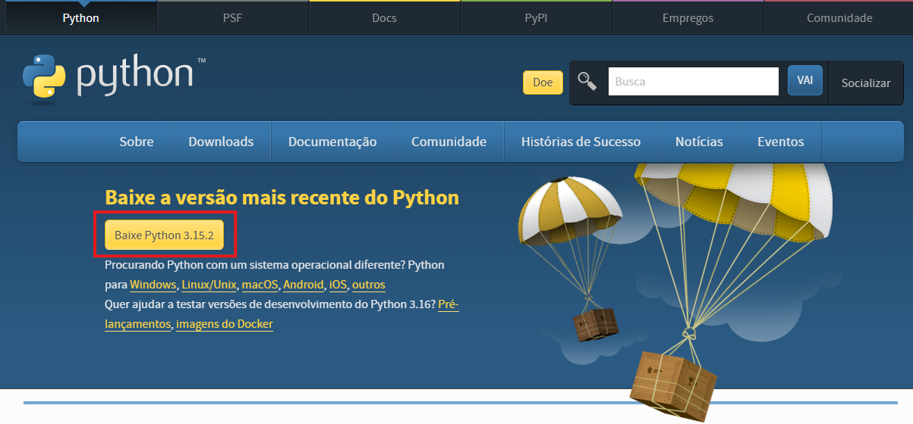
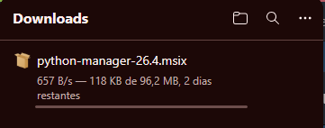
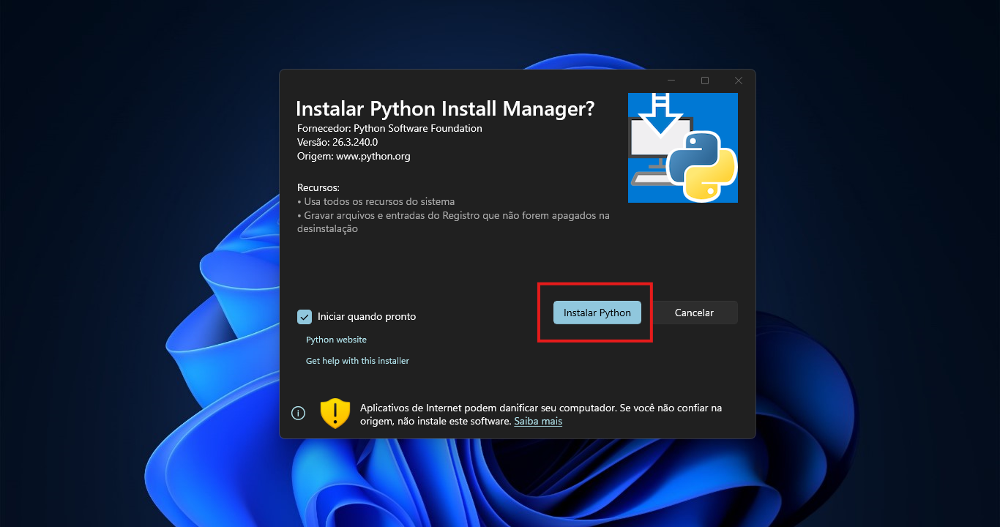
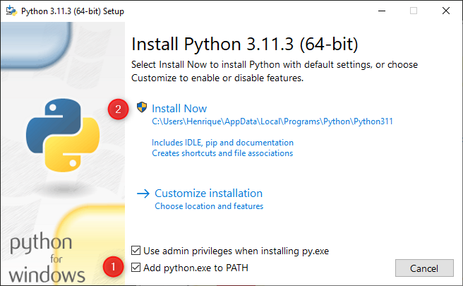
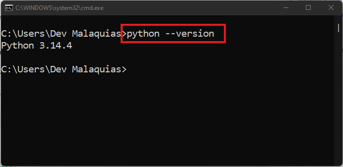
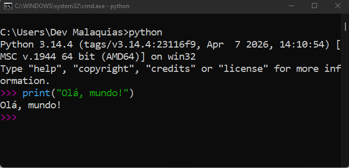

# Instalação do Python no Windows

Neste tutorial vais aprender a instalar o Python no teu computador, configurar o ambiente e executar o teu primeiro programa.

Não precisas de experiência em programação para acompanhar este guia.

## 1. Aceder ao site oficial do Python

O primeiro passo é aceder ao site oficial do Python:

[https://www.python.org/downloads/](https://www.python.org/downloads/)

Na página, encontrarás as opções para descarregar o Python para diferentes sistemas operativos.

Para este tutorial, vamos utilizar o Windows.



## 2. Descarregar o Python

Na página de downloads, selecciona a opção de instalação para Windows.

Descarrega o instalador recomendado para o teu computador.

Se estiveres a utilizar um computador Windows moderno, normalmente deves escolher a versão de 64 bits.



## 3. Executar o instalador

Depois de terminar o download:

1. Abre a pasta Downloads.
2. Localiza o ficheiro de instalação.
3. Clica duas vezes para executar o instalador.

<!--  -->

## 4. Instalar o Python

Na janela do instalador:

1. Selecciona a opção **Install Now**, quando estiver disponível.
2. Se a opção **Add Python to PATH** estiver disponível, activa-a.
3. Clica em **Install Now**.
4. Aguarda até a instalação terminar.

A opção Add Python to PATH facilita a execução de comandos Python directamente no terminal.



## 5. Confirmar a instalação

Depois de concluir a instalação:

1. Abre o menu Iniciar do Windows.
2. Procura por CMD ou Terminal.
3. Abre a aplicação.
4. Executa o seguinte comando:

```bash
python --version
```

Se o Python estiver correctamente instalado, será apresentada a versão instalada.

Exemplo:

```text
Python 3.x.x
```



## 6. Executar o primeiro programa

Agora vamos confirmar se o Python consegue executar código.

No terminal, escreve:

```bash
python
```

Depois, executa:

```python
print("Olá, mundo!")
```

Se aparecer:

```text
Olá, mundo!
```

Parabéns! O Python está instalado e pronto para ser utilizado.



## 7. Instalação concluída!

Concluíste a instalação do Python no teu computador.

Agora podes começar a aprender programação, desenvolver projectos e explorar o ecossistema Python.

Continua a tua aprendizagem com os tutoriais e exercícios disponíveis no PyNexo.

---

**PyNexo**

Aprender, partilhar e construir conhecimento.
