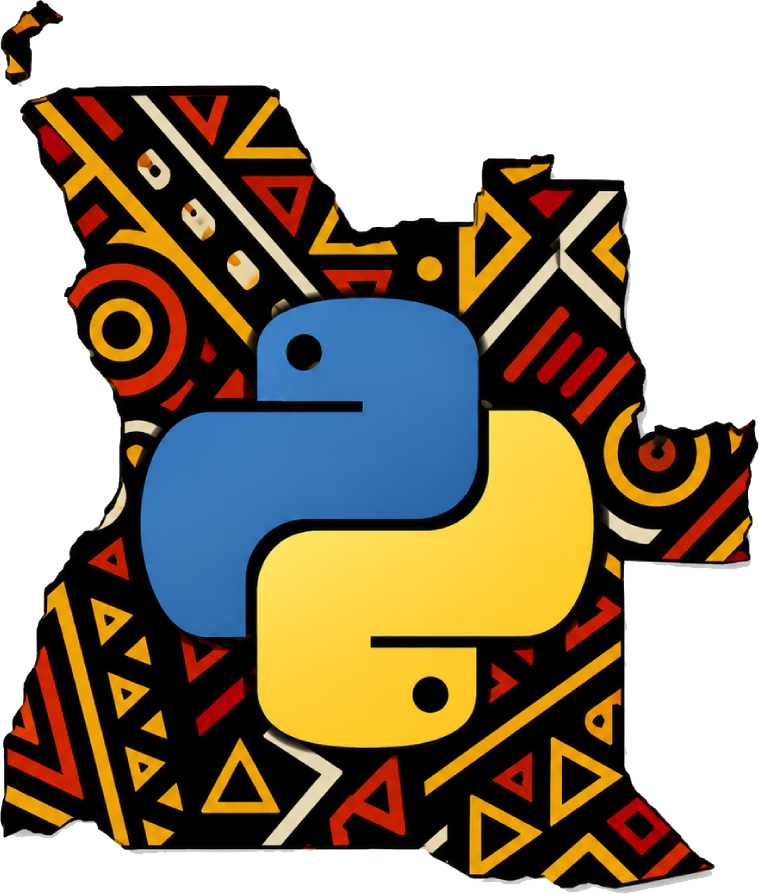

# PyNexo

## Aprender, partilhar e construir conhecimento.

Uma biblioteca aberta de conhecimento Python em língua portuguesa.

O PyNexo reúne tutoriais, exemplos de código, exercícios, guias e recursos educativos para apoiar a aprendizagem e o desenvolvimento de competências em Python.

É um projecto da **Python Angola Community**, desenvolvido de forma colaborativa e aberto à participação de toda a comunidade.

---

## Explora o PyNexo

### Fundamentos de Python

Aprende Python desde os primeiros passos, explorando os conceitos essenciais da linguagem e a construção dos teus primeiros programas.

[Começar a aprender](content/fundamentos/introducao.md){ .md-button .md-button--primary }

### Tutoriais e guias

Aprende através de explicações práticas, exemplos de código e guias sobre Python e o seu ecossistema.

### Exercícios e desafios

Pratica, resolve problemas e desenvolve o teu raciocínio através de desafios de programação.

### Bibliotecas e ferramentas

Explora bibliotecas, frameworks e ferramentas que ampliam as possibilidades de desenvolvimento com Python.

---

## Um projecto construído pela comunidade

O PyNexo pertence à Python Angola Community e está a ser desenvolvido com a participação da comunidade.

Todos podem contribuir, partilhando conhecimento, criando conteúdos, melhorando exemplos e propondo novos recursos.

<!-- [Como utilizar o PyNexo](como-utilizar.md){ .md-button } -->

[Contribuir para o projecto](contribuir.md){ .md-button .md-button--primary }

[Explorar no GitHub](https://github.com/filipemalaquias/PyNexo){ .md-button }

---

  

  **PyNexo · Python Angola Community**

  Aprender, partilhar e construir conhecimento.

